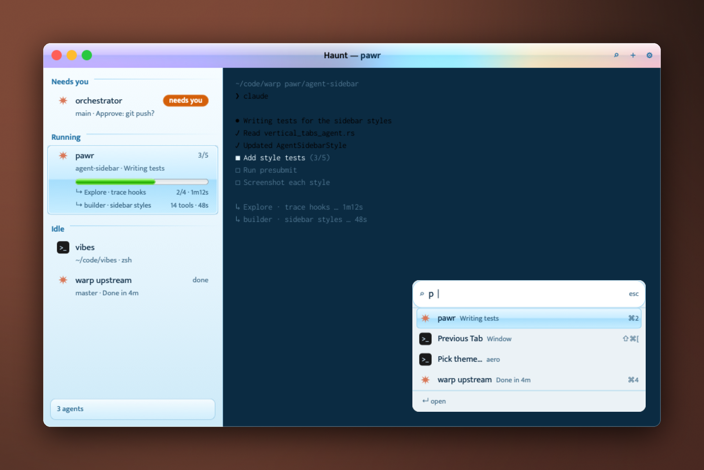

<div align="center">


# Frutiger Aero

**A glossy sky-blue Haunt theme with gel rows and a green progress bar.**

[](https://github.com/highskore/haunt-hackathon)


[](LICENSE)



</div>

A glossy 2007 sky for Haunt. The chrome is light glass over your desktop, with a gloss across the title bar and a sidebar that fades from white to sky blue. The selected tab is a blue gel with a shine along its middle, "needs you" is an orange gel pill, and progress fills a sunken track in glossy green. ⌘K opens a glass palette with a white search capsule.

## Install and switch

From the repo:

```sh
haunt plugin install .
```

Switch to it from ⌘K ▸ Pick theme…, or set it in `~/.haunt/config.toml`:

```toml
theme = "aero"
```

A copy you install yourself draws only the UI with its fonts, so the terminal falls back to your own monospace font. Inconsolata draws the terminal only when the theme ships with Haunt.

## Fonts

| Font | Use | Licence |
| --- | --- | --- |
| Mukta | UI | SIL Open Font License 1.1, [OFL-Mukta.txt](OFL-Mukta.txt) |
| Inconsolata | terminal | SIL Open Font License 1.1, [OFL-Inconsolata.txt](OFL-Inconsolata.txt) |

The theme itself is MIT ([LICENSE](LICENSE)).

## Effects

`theme.toml` turns on these `[effects]` keys. Haunt's [themes guide](https://github.com/highskore/haunt/blob/main/docs/themes.md) describes each one.

- Window: `window.material = "glass"`, `window.radius`, `window.ring`, `titlebar.rule`, `titlebar.lights = "color"`
- Sidebar: `sidebar.footer`, `label.case`, `label.weight`, `row.inset`, `row.radius`, `needs.pill`, `needs.weight = "bold"`, `bar.radius`, `bar.done`
- Palette: `palette.material = "glass"`, `palette.font`, `palette.icons`, `palette.selection = "pill"`, `palette.foot`, `palette.scrim`, `palette.keys`, `palette.input.icon`, `palette.tab.sub`

## Layers

Eleven `[[layer]]` tables draw the gloss: the title bar's shine, a highlight on each light, the sidebar's sky and its edge, a rule after each group label, the gel on the selected row and the selected palette entry, the needs pill, the progress track and fill, a glass card behind the agent count, and the search capsule.

## Not drawn

What the card shows that Haunt can't draw yet:

- the gloss's sheen doesn't move;
- the card's radial highlights are linear gradients here;
- the title-bar buttons aren't gel;
- no orb in the search field or at the foot, and no usage figure;
- the Claude badge isn't pearl;
- the wallpaper behind the glass is your desktop's.
